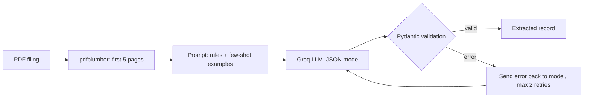

# Company Filing Extractor

### Week 17 — Structured Outputs, Pydantic Validation & Retry on NSE/BSE Results Filings

**Domain:** Fintech / Document Extraction **Techniques:** Prompt-only JSON, JSON mode, schema-constrained output, tool calling, Pydantic validation with retry, few-shot prompting **Data:** 34 NSE/BSE quarterly results announcements (PDF) **LLM provider:** Groq (free tier) — `openai/gpt-oss-120b` and a Qwen model

> **Disclaimer:** This project is a methodology exercise on getting reliable, structured data out of an LLM — it is not a production financial data pipeline and its output is not financial advice. The labeled set is small (34 filings, one labeler), so the numbers below show how the workflow behaves, not how it would perform at scale.

---

## Problem Statement

Apps and agents need data, not paragraphs. If downstream code expects `{"revenue_cr": 1234.5}` and the model replies "Revenue was about 1,234 crore", the pipeline breaks. Given the text of a company results announcement, this project extracts a fixed set of fields (company, period, basis, revenue, net profit, guidance, risks, and the evidence lines) as **validated JSON**.

It compares four ways of asking for structured output, then adds validation, retry and few-shot examples, to answer a specific question: **how accurate is the extraction, and how much do validation, retry and few-shot examples improve reliability?** The central lesson is that a *valid* output is not the same as a *correct* one, so the project measures both.

---

## Dataset

- **Source:** NSE/BSE corporate announcements (quarterly results). Source references are listed in `manifest.csv`; the PDFs themselves are not committed.
- **Size:** 34 filings, split into **10 dev** (used to tune prompts and few-shot examples) and **24 test** (used for the final numbers)
- **Text extraction:** `pdfplumber`, first 5 pages of each PDF. Scanned PDFs without a text layer were skipped.
- **Labels:** hand-made against a written labeling guide (see the notebook), including the evidence line for revenue and profit

---

## Key Design Decisions

**Missing values are `null`, not guesses.** Almost every field is `Optional`, and the prompt says "null if not stated". A model forced to fill every field will invent values, so `null` is treated as a legitimate answer.

**Evidence fields.** Revenue and profit each come with the exact sentence or table row the number was taken from. This makes an extracted figure checkable against the source text.

**The units trap.** Indian filings report in ₹ crore, lakh, million or plain rupees. Every amount is normalised to ₹ crore (1 crore = 10 million = 100 lakh), and the prompt tells the model to check the table heading for units before converting.

**Pydantic as the single source of truth.** The schema is defined once as a Pydantic class. It validates types, runs semantic checks (period format such as `Q2 FY27`, non-negative revenue), and exports the JSON schema used by the schema-constrained and tool-calling methods.

**Dev/test discipline.** Prompts and few-shot examples were tuned on the dev set only. The test set was used for final numbers.

---

## Pipeline



### Schema

| Field | Type | Notes |
|---|---|---|
| `company_name` | string | as written in the document |
| `period` | string or null | e.g. `Q2 FY27`; pattern-checked |
| `basis` | `consolidated` / `standalone` / null | which results were extracted |
| `revenue_cr` | float or null | revenue from operations, ₹ crore |
| `net_profit_cr` | float or null | profit after tax, ₹ crore; negative for a loss |
| `revenue_yoy_pct` | float or null | only if printed in the document |
| `guidance` | string or null | one-sentence management outlook |
| `risks` | list of strings | up to 5 explicitly mentioned risks |
| `revenue_evidence`, `profit_evidence` | string or null | exact source line for the figure |

---

## Methods Compared (dev set, 10 filings)

| Method | How structure is requested |
|---|---|
| A: Prompt-only JSON | "Respond only in JSON" in the prompt, then parse |
| B: JSON mode | `response_format={"type": "json_object"}` |
| C: Schema-constrained | `response_format` with `json_schema` and `strict=True` |
| D: Tool calling | one forced tool whose parameters are the Pydantic schema |

Each response is cached to disk by a hash of the model and prompt, so reruns cost no tokens and the free-tier rate limits are respected (a 5-second pause between calls).

### Validation and Retry

On a validation failure the model is sent its own output plus the Pydantic error message and asked for corrected JSON, up to 2 retries. After the retries a record that still fails would be flagged rather than silently accepted.

The final pipeline uses JSON mode with two few-shot examples taken from dev documents (one normal, one with several `null` fields).

---

## Results

### Method comparison (dev set)

| Method | Valid on first try | Typical failure |
|---|---|---|
| A: prompt-only JSON | 10/10 | `basis` not in allowed values |
| B: JSON mode | 10/10 | `basis` not in allowed values |
| C: schema-constrained | 10/10 | none |
| D: tool calling | 10/10 | unit not converted to crore |

### Retry loop and few-shot (dev set)

| Model | Prompt | First-try validity | Final validity | Retry rate | Evidence match |
|---|---|---|---|---|---|
| gpt-oss-120b | zero-shot | 2/10 | 10/10 | 80% | 100% |
| gpt-oss-120b | few-shot | 7/10 | 10/10 | 30% | 100% |
| Qwen | few-shot | 10/10 | 10/10 | 0% | 100% |

### Final evaluation (test set, 24 filings)

| Metric | Value |
|---|---|
| Documents evaluated | 24 |
| Schema validity: first try | 100% (Qwen), 91.67% (gpt-oss-120b) |
| Schema validity: after retry | 100% (both) |
| Retry rate | 0% (Qwen), 8.33% (gpt-oss-120b) |
| Evidence-match rate | 97.92% |
| Field accuracy: `revenue_cr` | 95.83% |
| Field accuracy: `net_profit_cr` | 100% |

Accuracy and evidence-match figures come from the Qwen run and were scored manually against my own labels. gpt-oss-120b was compared on validity and retries only. `revenue_yoy_pct` and `period` were not scored for accuracy: in this set the filings did not print the information those fields need, so the correct answer was `null` for nearly every document.

---

## Honest Interpretation

**Valid is not accurate.** Method D (tool calling) returned output that passed schema validation on all 10 dev documents, yet revenue and profit were wrong because the units were never converted to crore. The schema checks types, not whether 777.2 should have been 7,772. On the test set the same gap shows up: first-try validity was 100% for Qwen, but revenue accuracy was 95.83%, so one document had a valid but wrong revenue figure. The most common error was unit conversion.

**Few-shot examples helped, and this comparison is controlled.** With the same model (gpt-oss-120b) and the same retry loop, adding two few-shot examples moved first-try validity from 2/10 to 7/10 and cut retries from 80% to 30%. The Qwen row is a different model, so it should not be read as a few-shot effect.

**Retries fix malformed output, not wrong values.** On the dev set the retry loop recovered every failing record (10/10 final validity for both prompts). But a retry only responds to a validation error. A well-formed, plausible, wrong number never triggers one, which is why the evidence check (does the quoted line actually appear in the document?) matters. One evidence field in 48 on the test set (24 documents × 2) did not match.

**Small-sample caveat.** With 24 test documents, a single wrong field moves accuracy by about 4 points. Treat 95.83% and 100% as "works on most of this set", not as tight estimates. Scoring was manual and done by one person.

**Where I would not trust this without review:** documents with several unit conventions, banks and NBFCs where "revenue" is ambiguous, and any filing where the results table sits beyond the first 5 pages.

---

## Notebook Structure

```
Introduction
└── Goal, the four methods compared

Dataset
├── Source, 34 filings, first-5-pages text extraction
└── Dev / test split

Labeling Guide
└── Rules for revenue, profit, basis, units, nulls, evidence

Extraction Methods
├── Method A: prompt-only JSON
├── Method B: JSON mode
├── Method C: schema-constrained output (Pydantic schema + validators)
├── Method D: tool calling
└── Comparison table (dev set)

Validation and Retry
├── Few-shot prompt, retry loop with the validation error fed back
└── gpt-oss-120b vs Qwen on the dev set

Evaluation
└── Test-set results table

Insights
└── What worked, what did not, where it needs review
```

---

## How to Run

1. Put the filing PDFs in `/content/documents` (Colab) or update `docs_dir` in the Dataset section. The PDFs are not included in this repo; `manifest.csv` lists the NSE/BSE announcement references.
2. Add your Groq API key as a Colab secret named `GROQ_API_KEY` (never paste it into the notebook).
3. Run all cells in order (`Runtime → Run all`).

**Requirements:**

```
groq
pdfplumber
pydantic
pandas
```

Install with:

```
pip install groq pdfplumber pydantic pandas
```

Groq free-tier limits apply. Responses are cached in `/content/cache`, so rerunning the notebook reuses earlier calls.

---

## What I Would Do Next

- **Allow `null` revenue.** The `revenue_cr` validator currently rejects `None`, so a filing that genuinely has no revenue line triggers a pointless retry. It should only reject negative values.
- **Normalise `basis` in code.** The schema accepts both `"Consolidated"` and `"consolidated"`; a `mode="before"` validator that lowercases would keep one canonical value.
- **Convert units in code, not in the prompt.** Extract the raw number and its unit (`crore`, `lakh`, `million`) and convert with a plain Python lookup. Unit conversion was the most common error and arithmetic is a weak spot for LLMs.
- **Select pages instead of taking the first 5.** Keep only the pages that contain "Revenue from operations" or "Profit after tax", so a table on page 6 is not missed.
- **Run the evidence check in code and flag failures.** Check that each evidence line appears in the source text, and set `needs_review` instead of returning a possibly wrong value.
- **Score all fields.** Add guidance and risks scoring, and report the false-value and missed-value rates for `null` handling.
- **More data and a second labeler.** A larger test set, with a sample re-labeled by someone else, would give tighter and more trustworthy accuracy numbers.
- **Streaming, a tool-calling loop, `instructor` and Ollama.** Planned for a separate notebook, since they need little data and few tokens.

---

*Part of the [AI-ML-Journey](https://github.com/Himanshu13-Programs/AI-ML-Journey) repository.*
